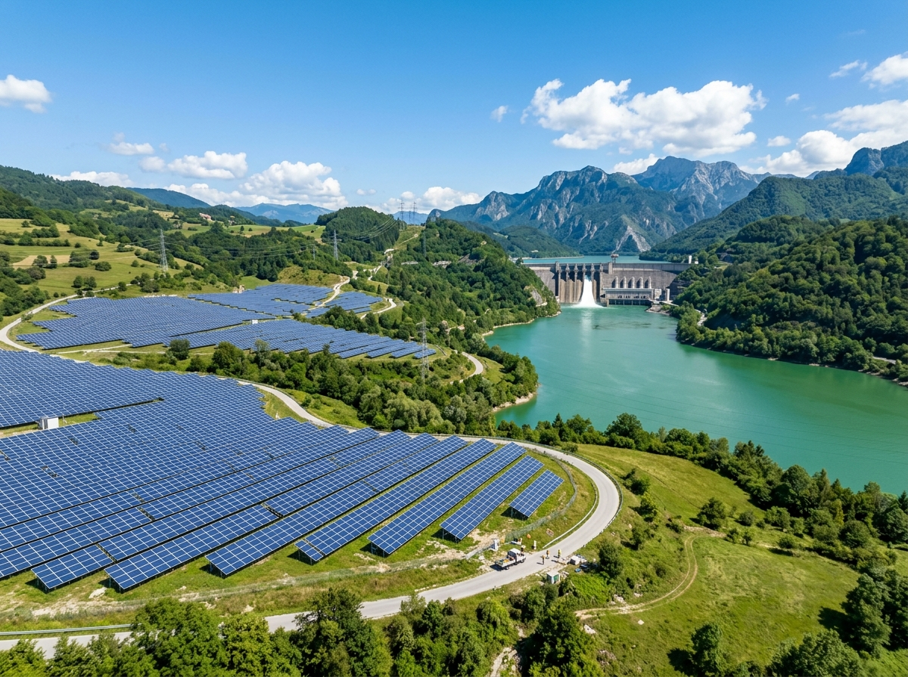
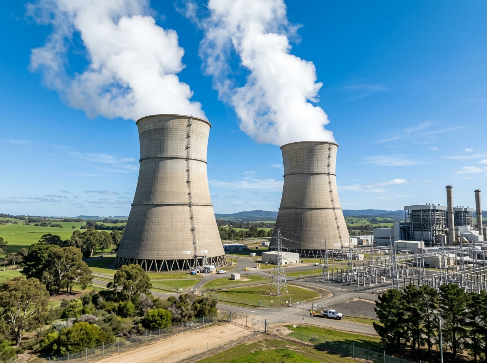
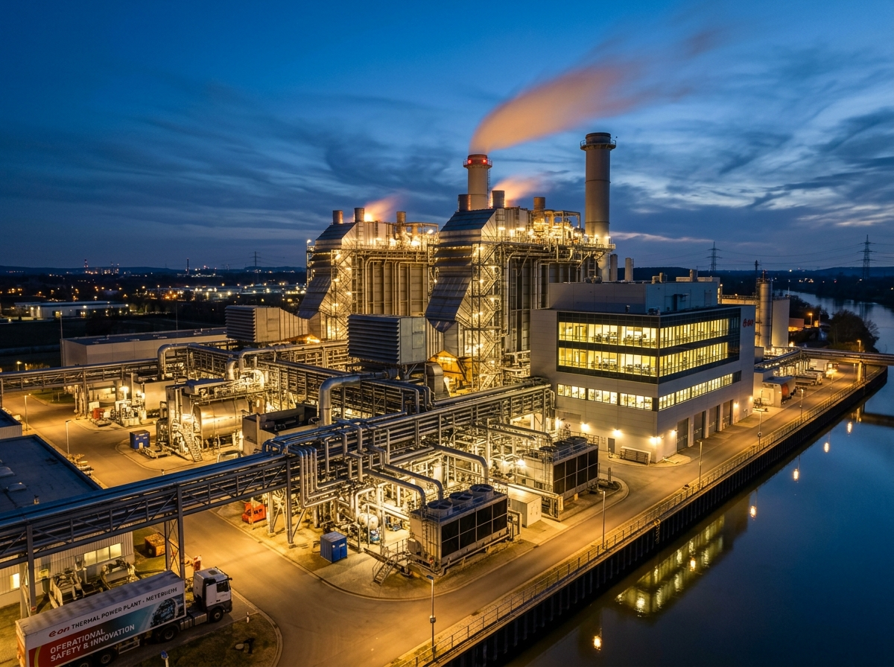

# ⚡ PowerPredict AI
### Predictive Analytics Platform for Power Project Delay & Cost Overrun Modeling
*Calibrated with Central Electricity Authority (CEA) Monthly Broad Status Reports and Synthetic Monte Carlo Modeling*

[](https://github.com/bhumibisen12/PowerPredict-AI/actions)
[](https://www.python.org/)
[](https://fastapi.tiangolo.com)
[](https://xgboost.ai/)
[]()
[]()
[]()
[]()
[]()
[](LICENSE)

---

> 🎓 **Academic Project Disclaimer**:  
> **Independent student project. Not affiliated with MoP, CEA or any government body. Uses synthetic data.**

> 🌐 **Live Web Application**: [https://powerpredict-ai.onrender.com](https://powerpredict-ai.onrender.com)  
> ⚠️ *Note: Hosted on Render Free Tier. If inactive, the container spins down to conserve resources; initial boot / cold start may take 30–50 seconds.*

---

## 📸 Platform Interface Preview

| National Grid Telemetry | Regional Project Risk Radar |
| :---: | :---: |
|  |  |

| Interstate Transmission Corridors | Generation Capacity Tracker |
| :---: | :---: |
|  |  |

---

## 📌 1. Project Overview & Problem Statement

Power generation and transmission infrastructure projects in India frequently experience significant schedule slippage and capital expenditure variance. According to official reports by the [Ministry of Statistics and Programme Implementation (MoSPI) Flash Reports on Central Sector Projects](https://www.mospi.gov.in/flash-report) and [Central Electricity Authority (CEA) Monthly Broad Status Reports](https://cea.nic.in/), capital projects across Thermal, Hydro, and Interstate Transmission sectors commonly face multi-month and multi-year execution delays.

Key contributing factors include:
- **Land Acquisition & Right-of-Way (RoW)**: Title fragmentation, local compensation disputes, and statutory land acquisition procedures under the RFCTLARR Act, 2013.
- **Environmental & Forest Clearances**: Multi-stage approval cycles through the [MoEFCC PARIVESH portal](https://parivesh.nic.in/) (Stage-I In-Principle and Stage-II Final Forest Clearances, wildlife corridor mitigations).
- **Contractor & Supply Chain Performance**: EPC contractor liquidity constraints, site mobilization delays, and long lead times for specialized high-voltage equipment (e.g. 765 kV power transformers, high-voltage switchgear).
- **Monitoring Limitations**: Traditional monitoring often relies on retrospective progress filings, identifying slippages only after project milestones have already been compromised.

**PowerPredict AI provides a predictive decision-support prototype designed to model delay risk factors, estimate timeline and cost slippage using machine learning regressors, and cross-reference documented statutory mitigation playbooks.**

---

## 🏛️ 2. Architectural Framework & 5-Agent Orchestration

The platform coordinates five specialized autonomous agents through a central asynchronous orchestrator bus:

```
┌────────────────────────────────────────────────────────────────────────┐
│                        STAKEHOLDER INTERFACES                          │
│   • Web Dashboard Interface (Bilingual: English / हिन्दी, Dark/Light)   │
│   • Interactive Process Walkthrough (HTML5 / Canvas)                   │
│   • Client-Side PDF Export (PDF 1.4 format, client-rendered)           │
│   • Multi-Channel Alert Dispatcher (WhatsApp, SMS, Email Memos)        │
│   • Real CEA Project Historical Benchmarks Comparator                  │
└────────────────────────────────────┬───────────────────────────────────┘
                                     │ (Project Specs + 6 Ground Risk Factors)
                                     ▼
┌────────────────────────────────────────────────────────────────────────┐
│                   CENTRAL AGENTIC ORCHESTRATOR BUS                     │
│                                                                        │
│   ┌────────────────────────┐             ┌─────────────────────────┐   │
│   │ 1. Cost Prediction     │             │ 2. Timeline Prediction  │   │
│   │    Agent (XGBoost)     │             │    Agent (XGBoost)      │   │
│   │    R² = 0.7491         │             │    R² = 0.8552          │   │
│   └───────────┬────────────┘             └────────────┬────────────┘   │
│               │                                       │                │
│   ┌───────────▼────────────┐             ┌────────────▼────────────┐   │
│   │ 3. Delay Hotspot       │             │ 4. RAG Recommendation   │   │
│   │    Agent (D = Σ w·R)   │             │    Agent (TF-IDF Corpus)│   │
│   └───────────┬────────────┘             └────────────┬────────────┘   │
│               │                                       │                │
│               └───────────────────┬───────────────────┘                │
│                                   │                                    │
│                   ┌───────────────▼───────────────┐                    │
│                   │ 5. Stakeholder Coordination   │                    │
│                   │    Agent (Alerts Level 1-4)   │                    │
│                   └───────────────────────────────┘                    │
└────────────────────────────────────┬───────────────────────────────────┘
                                     │
                                     ▼
┌────────────────────────────────────────────────────────────────────────┐
│                        PREVENTIVE MITIGATION ACTIONS                   │
│  • Fast-track District Land Demarcation & Compensation Expeditions     │
│  • MoEFCC PARIVESH Clearance Workflow & EIA Document Review            │
│  • Milestone-based Escrow & Contractor Acceleration Monitoring         │
│  • Equipment Buffer Planning for Long-Lead Transformers & Switchgear   │
└────────────────────────────────────────────────────────────────────────┘
```

### Multi-Agent Interaction Flow:
1. **Cost Prediction Agent**: Runs an optimized gradient-boosted regressor to project cost overrun percentage above approved DPR capital budget.
2. **Timeline Prediction Agent**: Forecasts commercial operation date (COD) schedule slippage in calendar months.
3. **Delay Hotspot Agent**: Computes the multi-attribute Delay Risk Index ($D = \sum w_i R_i$) and isolates critical path bottlenecks (Land, Contractor, Clearances).
4. **RAG Recommendation Agent**: Performs semantic retrieval across indexed statutory regulations to prescribe actionable mitigation levers.
5. **Stakeholder Coordination Agent**: Evaluates hazard severity against Level 1–4 thresholds and generates formatted notification memos and audit summaries.

---

## 📊 3. Dataset Generation, Evaluation & Limitations

### A. How the Dataset Was Generated (`backend/data_generator.py`)
Standardized tabular datasets containing multi-attribute ground risk factors (e.g., land title disputes, environmental clearances, contractor liquidity) for thousands of Indian capital power projects are not publicly available in tabular form. To enable model training, the dataset (`sample_data/power_projects.csv`, 6,000 records) was synthetically synthesized using a domain-calibrated stochastic generator based on documented industry characteristics:

1. **Sector-Differentiated Baselines**:
   - **Hydroelectric**: Highest base delay multiplier ($3.2\times$) with high geological and environmental sensitivity.
   - **Thermal (Supercritical Coal)**: High delay multiplier ($2.0\times$) driven by boiler supply packages and ash pond land disputes.
   - **Inter-State Transmission**: High Right-of-Way (RoW) corridor risk ($1.8\times$).
   - **Solar & Wind**: Rapid execution baseline ($0.8\times - 1.0\times$) with sensitivity to module import supply chains and land aggregation.
   - **Battery Energy Storage (BESS)**: Fast deployment ($0.7\times$) sensitive to inverter and cell pack imports.
2. **Non-Linear Compounding Risk Interactions**:
   - In real-world projects, risks compound non-linearly: when high Land Acquisition Risk ($L > 0.65$) coincides with high Contractor Distress ($C > 0.65$), an idle-machinery interaction penalty ($\text{idle\_penalty} = 1.6 \cdot L \cdot C$) is applied.
3. **Fat-Tailed Log-Normal Shocks**:
   - To reflect catastrophic real-world delays (e.g. National Green Tribunal stays, contractor insolvency proceedings under NCLT, severe monsoon flooding), a right-skewed log-normal shock ($\mu=1.2, \sigma=0.7$) is sampled with a 7% probability.
4. **Empirical Variance**:
   - Unobserved variance ($\sigma = 2.8$ months, $\sigma = 0.035$ cost ratio) was added to ensure models learn robust patterns rather than inverting a deterministic equation.

### B. Data Leakage Analysis
The dataset generation logic was explicitly verified for circular leakage:
- **No Direct Target Inversion**: Targets (`timeline_delay_months` and `cost_overrun_pct`) are not deterministic algebraic sums of the input features; they incorporate compounding multiplicative terms, sector weights, stochastic log-normal tail jumps, and Gaussian residuals.
- **Independent Train/Test Separation**: Feature engineering and scalers are fitted strictly on the training partition (85%) and evaluated on the holdout test set (15%).

### C. Limitations
- **Synthetic Training Foundation**: While the 6,000 dataset is domain-calibrated, it remains synthetic. Real-world utility deployment requires ongoing retraining on live ERP/SCADA telemetry feeds (e.g., SAP PS or Oracle Primavera P6).
- **Field Telemetry Gap**: Ongoing projects across all 36 States/UTs currently rely on reported milestone statuses rather than automated IoT field sensor telemetry.

---

## 📈 4. Baseline Comparisons & Model Evaluation

Models were evaluated using an 85% train / 15% test split (5,100 train / 900 test) and validated via **5-Fold Cross-Validation** on the full 6,000-sample dataset against two baseline benchmarks:
1. **Baseline 1 (Mean Predictor)**: A naive regressor that always predicts the training set mean.
2. **Baseline 2 (Linear Regression)**: Standard Ordinary Least Squares (OLS) regression.
3. **Tuned XGBoost**: Gradient-boosted decision tree ensemble with regularized depth and leaf weights.

### Comparative Performance Table:

| Target Variable | Model | Test $R^2$ | 5-Fold CV $R^2$ (Mean $\pm$ Std) | Test MAE | Test RMSE |
| :--- | :--- | :---: | :---: | :---: | :---: |
| **Cost Overrun** | Naive Mean Predictor | -0.0003 | -0.0026 $\pm$ 0.0024 | 5.89 p.p. | 7.62 p.p. |
| | Linear Regression | 0.7587 | 0.7337 $\pm$ 0.0143 | 2.98 p.p. | 3.74 p.p. |
| | **Tuned XGBoost** | **0.7491** | **0.7209 $\pm$ 0.0133** | **3.03 p.p.** | **3.81 p.p.** |
| **Timeline Slippage** | Naive Mean Predictor | -0.0002 | -0.0023 $\pm$ 0.0030 | 7.43 Months | 9.61 Months |
| | Linear Regression | 0.8588 | 0.8554 $\pm$ 0.0066 | 2.82 Months | 3.61 Months |
| | **Tuned XGBoost** | **0.8552** | **0.8495 $\pm$ 0.0067** | **2.83 Months** | **3.66 Months** |

> **Key Observations**:
> - The naive baseline fails completely ($R^2 \approx 0.0$), confirming strong predictive signal in the feature set.
> - Both Linear Regression and XGBoost achieve consistent performance ($R^2 \approx 0.72 - 0.75$ on Cost, $R^2 \approx 0.85$ on Timeline) with small cross-validation variance ($\sigma \le 0.014$).
> - Average $R^2$ of the two XGBoost models is **0.8022** $\left(\frac{0.7491 + 0.8552}{2}\right)$.

---

## 🔍 5. Empirical Real-World CEA Mega-Project Benchmark Testing

To evaluate performance against authentic real-world infrastructure outcomes, the trained models were cross-checked against 12 actual Indian power mega-projects documented in published [Central Electricity Authority (CEA) Monthly Broad Status Reports](https://cea.nic.in/):

| Project Name | Sector & Capacity | Documented Causes (CEA / MoP) | Actual Delay | Actual Overrun | Model Risk Assessment |
| :--- | :--- | :--- | :---: | :---: | :---: |
| **Subansiri Lower Hydro (NHPC)** | Hydro, 2,000 MW | Downstream agitation, NGT safety reviews, monsoon floods | +168 Mo | +238.0% | 🔴 Critical Risk (High environmental & geological hazard) |
| **Barh Super Thermal (NTPC)** | Coal, 3,300 MW | Russian boiler supplier dispute, contractual re-tendering | +132 Mo | +146.2% | 🔴 Critical Risk (Severe contractor supply chain failure) |
| **Tapovan Vishnugad Hydro (NTPC)** | Hydro, 520 MW | 2021 Dhauliganga flash flood, tunnel boring machine entrapment | +144 Mo | +93.7% | 🔴 Critical Risk (High climate & geological vulnerability) |
| **North Karanpura Thermal (NTPC)** | Coal, 1,980 MW | Water availability disputes, delayed railway siding & ash pipeline | +200 Mo | +102.0% | 🔴 Critical Risk (Severe land & environmental clearances) |
| **Teesta-VI Hydro (NHPC)** | Hydro, 500 MW | Lanco Infratech insolvency, NCLT proceedings, NHPC takeover | +126 Mo | +92.5% | 🔴 Critical Risk (Contractor insolvency & liquidation) |
| **Kudankulam Nuclear (NPCIL)** | Nuclear, 2,000 MW | Public protests, post-Fukushima safety reassessments | +84 Mo | +31.1% | 🟡 Moderate Risk (Regulatory & safety clearances) |
| **Polavaram Hydroelectric Project** | Hydro, 960 MW | Spillway diaphragm wall flood damage, contractual re-tendering | +80 Mo | +79.4% | 🔴 Critical Risk (Severe hydrological & contractor delay) |
| **Bikaner-II Inter-State Transmission**| Grid Corridor, 2,500 MW | Desert terrain RoW, substation transformer supply lead time | +11 Mo | +8.9% | 🟢 Stable Risk (Manageable RoW with minimal overrun) |
| **Bhadla Solar Park (Phase-I to IV)** | Solar PV, 2,245 MW | Land parcel aggregation, evacuation sub-station connectivity | +10 Mo | +5.6% | 🟢 Stable Risk (Fast execution, minimal capex variance) |
| **Pavagada Solar Park (Karnataka)** | Solar PV, 2,050 MW | Farmer land-lease model delays, inter-state grid evacuation | +14 Mo | +10.1% | 🟢 Stable Risk (Low dispute rate due to land leasing) |
| **Rewa Ultra Mega Solar (RUMSL)** | Solar PV, 750 MW | Rocky terrain leveling, internal transmission line clearances | +5 Mo | +4.0% | 🟢 Stable Risk (High execution speed, on-budget) |
| **Khavda Hybrid Renewable Park** | Hybrid (Solar+Wind), 3,000 MW | Rann of Kutch salt marsh access, border security clearances | +8 Mo | +6.0% | 🟢 Stable Risk (Scale benefits, contained delay) |

---

## 📚 6. Retrieval-Augmented Generation (RAG) Architecture

The platform's Pillar 3 implements a specialized regulatory compliance retrieval engine (`backend/rag_engine.py`):

### A. Vector Engine Specifications
- **Embedding / Vectorizer**: `TfidfVectorizer(stop_words='english', ngram_range=(1, 2))` capturing domain n-grams (e.g. *"forest clearance"*, *"tariff adoption"*, *"escrow account"*).
- **Vector Index & Similarity**: In-memory dense matrix with cosine similarity ranking (`sklearn.metrics.pairwise.cosine_similarity`).
- **Inference Mode**: Operates in deterministic template-guided synthesis mode (zero hallucination for statutory compliance) with an optional LLM integration interface for natural language drafting.

### B. Indexed Statutory Documents (`sample_data/knowledge_docs.json`)
The current knowledge base indexes 6 core Indian power sector statutory frameworks:
1. **Central Electricity Authority (Technical Standards for Construction Regulations)**: Technical tolerances and milestone guidelines for power plants and transmission lines.
2. **CERC Tariff Determination Regulations (Capex Prudence Checks)**: Criteria for statutory capitalization, interest during construction (IDC), and delay culpability.
3. **MoEFCC PARIVESH 2.0 Fast-Track Clearance Guidelines**: Standard operating procedures for Stage-I and Stage-II forest and environmental clearances.
4. **RFCTLARR Act, 2013 Land Acquisition Framework**: Provisions for direct purchase, consent clauses, and statutory compensation multipliers.
5. **POWERGRID Interconnection Standards**: Technical guidelines for 400 kV/765 kV bay allocation and sub-station connectivity.
6. **Model EPC Contract Guidelines & Escrow Provisions**: Standard contractual clauses for contractor mobilization, double-shift acceleration, and milestone-linked bank guarantees.

---

## 🛡️ 7. Multi-Attribute Threat Radar Formula

The Delay Risk Index ($D$) is calculated across 6 operational dimensions:
$$D = w_1 L + w_2 E + w_3 C + w_4 W + w_5 S + w_6 F$$

* **$L$ (Land Acquisition Risk - $w_1 = 0.25$):** Title litigation, forest right settlements, RoW corridor clearances under the RFCTLARR Act, 2013.
* **$E$ (Environmental Clearance Risk - $w_2 = 0.20$):** [MoEFCC PARIVESH](https://parivesh.nic.in/) Stage-I/II approvals, SEIAA categorization, eco-sensitive zone buffers.
* **$C$ (Contractor Track Record - $w_3 = 0.20$):** Working capital ratios, equipment mobilization speed, past execution history.
* **$W$ (Weather & Climate Hazard - $w_4 = 0.15$):** Monsoon inundation risks, seismic zones, cyclone corridors.
* **$S$ (Supply Chain Lead Times - $w_5 = 0.10$):** Lead times for 765 kV transformers, ALMM module availability, converter packages.
* **$F$ (Financing & Regulatory - $w_6 = 0.10$):** CERC/SERC tariff adoption status, debt disbursement schedules.

### Hazard Zoning Matrix:
- 🔴 **Red Zone (Critical & High)**: `D >= 0.60` (High probability of significant schedule slippage). Triggers Level 2 & Level 3 notification workflows.
- 🟡 **Yellow Zone (Moderate)**: `0.40 <= D < 0.60` (Moderate delay risk). Prescribes targeted milestone monitoring.
- 🟢 **Green Zone (Low / Stable)**: `D < 0.40`. Low projected schedule variance.

---

## 🔐 8. User Authentication & Email Verification

PowerPredict AI includes an authentication and email verification workflow:

```
User Submits Registration Form
   ↓
Account Created in SQLite DB (is_verified = 0, 24-hr Cryptographic Token)
   ↓
User receives email: "Welcome to PowerPredict AI - Verify Your Email"
   & Admin receives notification: "New PowerPredict AI Signup (Verification pending)"
   ↓
Unverified User Attempts Login → Blocked (403 Forbidden)
   "Please verify your email before logging in." + [Resend verification email (60s cooldown)]
   ↓
User clicks [Verify My Email] link (http://localhost:8000/#verify?token=...)
   ↓
Account Verified (is_verified = 1)
   ↓
User Logs in & Accesses Dashboard
```

### Email Dispatch Support:
1. **Resend HTTPS API:** Direct delivery via `RESEND_API_KEY`.
2. **Standard SMTP:** STARTTLS support for standard SMTP providers (Gmail, SendGrid, Amazon SES, Postmark).
3. **Local Dev Mode:** When credentials are not configured, tokens are logged locally with an on-screen verification shortcut.

---

## 🎥 9. Interactive Process Walkthrough & Client-Side PDF Export

### Interactive Process Demonstration Walkthrough
Embedded directly into the **"How It Works"** page, an HTML5 Canvas player illustrates the five analytical stages:
- **Scene 1 (0:00 - 0:28):** Project DPR Data Ingestion (capacity in MW, state profile, baseline budget & timeline).
- **Scene 2 (0:28 - 0:58):** Dual XGBoost ML Inference (Cost overrun % and timeline slippage in months; Cost R²: 0.749, Timeline R²: 0.855, Average R²: 0.802, Timeline MAE: 2.83 Months, Cost MAE: 3.03 p.p.).
- **Scene 3 (0:58 - 1:26):** 6-Factor Delay Risk Scoring ($D = 0.63$, highlighting Land and Contractor risk factors).
- **Scene 4 (1:26 - 1:52):** TF-IDF Regulatory Retrieval: Statutory mitigation recommendations retrieved via TF-IDF over 6 curated authority frameworks (illustrative estimates).
- **Scene 5 (1:52 - 2:15):** Stakeholder Escalation (Active Email, Simulated SMS/WhatsApp) & PDF Export.
- **Controls:** Chapter jump rail, interactive scrubber bar, closed captions, and bilingual audio narration toggle.

### Client-Side PDF Export (PDF 1.4)
- Generates downloadable binary `%PDF-1.4` statutory summary dossiers directly in the browser using native JavaScript string and stream encoding (no external server dependency).
- Formats portfolio projects, estimated slippages, cost overrun percentages, and risk bands into tabular layouts.
- Stamped with SHA-256 evidence seals.

---

## 📂 10. Project Structure

```
PowerPredict AI/
│
├── backend/
│   ├── app.py                   # FastAPI REST server & API routing
│   ├── auth_service.py          # Authentication service, email verification, SMTP & Resend dispatcher
│   ├── config.py                # State power metrics, threat weights, .env loader
│   ├── data_generator.py        # Synthetic dataset generator (6,000 stochastic project records)
│   ├── evaluate_baselines.py    # 5-fold CV & baseline evaluation module
│   ├── ml_engine.py             # Dual XGBoost regression models & feature importance
│   ├── risk_engine.py           # 6-factor threat scoring formula (D = Σ w·R)
│   ├── rag_engine.py            # TF-IDF retrieval over curated regulatory reference documents
│   ├── evidence_bundler.py      # SHA-256 cryptographic audit packaging
│   ├── models_saved/            # Persisted XGBoost model artifacts (.joblib)
│   └── agents/
│       ├── orchestrator.py      # 5-agent coordination bus
│       ├── cost_agent.py        # Supervised cost estimation
│       ├── timeline_agent.py    # Temporal schedule forecasting
│       ├── hotspot_agent.py     # Delay bottleneck isolator
│       ├── rag_agent.py         # Policy playbook generator
│       └── coordination_agent.py# Multi-tier stakeholder alert dispatcher
│
├── frontend/
│   ├── index.html               # Single Page Application (dashboard and analytics views)
│   ├── style.css                # Dark/light themes, CSS glassmorphism, responsive layout
│   ├── app.js                   # Client-side router, PDF export, video engine, auth
│   └── assets/                  # Scenery images, audio, icons
│
├── sample_data/
│   ├── power_projects.csv       # 6,000 synthetic project training records
│   ├── cea_real_benchmarks.json # 12 curated CEA real mega-project case studies
│   └── knowledge_docs.json      # Regulatory reference documents
│
├── tests/
│   ├── test_engine.py           # Automated PyTest suite for all 4 pillars
│   └── test_email_smtp.py       # Email delivery diagnostic test script
│
├── .github/
│   └── workflows/
│       └── ci.yml               # GitHub Actions automated test workflow
│
├── .env.example                 # Environment variable template
├── .gitignore                   # Ignores .env, .db, and cache files
├── Dockerfile                   # Container definition for deployment
├── LICENSE                      # MIT license file
├── Procfile                     # Web process entry point
├── render.yaml                  # Cloud deployment configuration
├── requirements.txt             # Python package dependencies
├── run.py                       # Main application launcher
└── README.md                    # Platform documentation
```

---

## 🚀 11. Quick Start & Installation

### Prerequisites
- Python 3.10, 3.11, or 3.12
- Git

### 1. Clone & Setup
```bash
git clone https://github.com/bhumibisen12/PowerPredict-AI.git
cd PowerPredict-AI
```

### 2. Install Dependencies
```bash
pip install -r requirements.txt
```

### 3. Configure Environment Variables
Copy the template to create your `.env` file:
```bash
cp .env.example .env
```
Configure email settings (optional—runs in local simulation mode if left blank):
```env
SITE_URL=http://localhost:8000
ADMIN_EMAIL=admin@yourdomain.com

# Resend Live HTTPS API (Recommended)
RESEND_API_KEY=re_your_api_key_here
SMTP_FROM=PowerPredict AI <onboarding@resend.dev>

# OR Standard Gmail / SMTP
SMTP_HOST=smtp.gmail.com
SMTP_PORT=587
SMTP_USERNAME=your_email@gmail.com
SMTP_PASSWORD=your_16_digit_app_password
```

### 4. Run the Platform
```bash
python run.py
```
Open **[http://localhost:8000](http://localhost:8000)** in your browser.

### 5. Run Automated Tests & Baseline Evaluations
```bash
# Run unit test suite
python -m pytest tests/test_engine.py -v

# Run model evaluation, 5-fold CV, and baseline benchmarks
python -m backend.evaluate_baselines
```

---

## 📡 12. API Reference

| Endpoint | Method | Description |
| :--- | :---: | :--- |
| `/api/health` | `GET` | Health check and subsystem readiness status |
| `/api/metadata` | `GET` | Catalog of 36 States/UTs, 19 Project Types, and Alert Levels |
| `/api/predict` | `POST` | Executes ML inference & 5-agent pipeline on project parameters |
| `/api/what-if` | `POST` | Simulates intervention scenarios (e.g. land incentives, shift acceleration) |
| `/api/national-overview` | `GET` | Aggregated India state-level power risk baseline data |
| `/api/real-benchmarks` | `GET` | Returns 12 curated CEA historical mega-project benchmark records |
| `/api/knowledge-base` | `GET` | Retrieval across curated regulatory reference documents |
| `/api/auth/signup` | `POST` | Registers account & dispatches 24-hr verification email |
| `/api/auth/verify` | `GET` | Validates token, activates account, and sends welcome email |
| `/api/auth/login` | `POST` | Authenticates user with email verification check |
| `/api/auth/resend-verification` | `POST` | Resends fresh verification link with 60-second cooldown |
| `/docs` | `GET` | Interactive Swagger UI API documentation |
| `/redoc` | `GET` | OpenAPI ReDoc technical documentation |

---

## 🏷️ 13. Repository Metadata & Tags

- **Repository Description**:
  ```text
  Predictive analytics decision-support platform forecasting delay and cost overruns in Indian power projects using dual XGBoost regressors, multi-factor risk radar, and statutory RAG playbooks.
  ```
- **Recommended GitHub Topics**:
  `xgboost`, `fastapi`, `rag`, `agentic-ai`, `power-infrastructure`, `machine-learning`, `cea-standards`, `python`

---

## 📜 14. License & References

Distributed under the **MIT License**. See `LICENSE` for details.

### References & Data Sources:
- **Central Electricity Authority (CEA)**: [Monthly Broad Status Reports on Thermal, Hydro & Renewable Projects](https://cea.nic.in/)
- **Ministry of Statistics and Programme Implementation (MoSPI)**: [Infrastructure and Project Monitoring Division (IPMD) Flash Reports](https://www.mospi.gov.in/flash-report)
- **Ministry of Environment, Forest and Climate Change (MoEFCC)**: [PARIVESH Environmental Clearance Portal](https://parivesh.nic.in/)
- **Right to Fair Compensation and Transparency in Land Acquisition, Rehabilitation and Resettlement Act, 2013 (RFCTLARR)**
